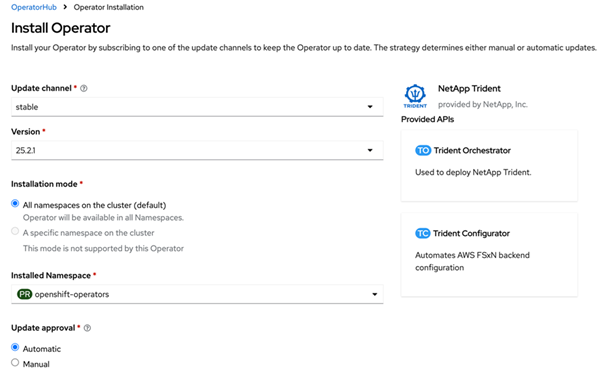
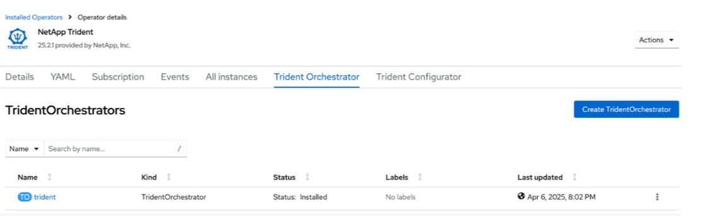

= Instala Trident usando OpenShift OperatorHub
:hardbreaks:
:allow-uri-read: 
:icons: font
:imagesdir: ../media/

[role="lead"]
Si usas Red Hat OpenShift, puedes instalar NetApp Trident usando el operador certificado de Red Hat. Usa este procedimiento para instalar Trident desde la plataforma Red Hat OpenShift Container Platform.

.Antes de empezar
Antes de comenzar la instalación, link:../trident-get-started/requirements.html["prepara tu entorno para la instalación de Trident"].

[[find-and-install-the-trident-operator]]
== Busca e instala el operador Trident

.Pasos
. Ve a OpenShift OperatorHub y busca NetApp Trident.
+
image::../media/openshift-operator-01.png[Trident Operator]

. Haz clic en *NetApp Trident* para abrir la configuración de la instalación.
. Selecciona las opciones necesarias y haz clic en *Instalar* para abrir la configuración del Operator.
+
image::../media/openshift-operator-02.png[Instalar]

+

NOTE: Asegúrate de seleccionar la versión más reciente del Operator.

. Mantén todos los parámetros como están y haz clic en *Instalar*.
+

. Haz clic en *Ver operador* para ver los detalles del operador.
+
image::../media/openshift-operator-07.png[Instalado]

. Haz clic en *YAML view* y pega lo siguiente en el formulario:
+
[source, yaml]
----
apiVersion: trident.netapp.io/v1
kind: TridentOrchestrator
metadata:
  name: trident
  namespace: openshift-operators
spec:
  IPv6: false
  debug: false
  nodePrep:
  - iscsi
  imageRegistry: ''
  k8sTimeout: 180s
  namespace: trident
  silenceAutosupport: false
----
+
[NOTE]
====
La interfaz de usuario proporciona un ejemplo por defecto. Puedes editarlo directamente en lugar de copiar una configuración completa.

====

[NOTE]
====
Opcional: activar la concurrencia

Para activar la concurrencia, agrega el siguiente campo a la especificación:

[source, yaml]
----
enableConcurrency: true
----
====
[NOTE]
====
* Red Hat Enterprise Linux CoreOS (RHCOS) no tiene iSCSI habilitado ni configurado.
* Puedes añadir el parámetro `nodePrep` para configurar y habilitar tanto los servicios iSCSI como Multipath en todos los nodos worker de OpenShift.
* A partir de OpenShift 4.19, la versión mínima de Trident compatible con esta función es 25.06.1.

====
. Haz clic en *Crear*; el orquestador Trident estará completamente instalado.
+

[[uninstall-trident-operator]]
== Desinstalar Trident operator

.Pasos
. Selecciona el operador Trident de la lista de operadores instalados.
. Selecciona si quieres eliminar todas las instancias de operand del operador.
+

WARNING: Si no seleccionas la casilla *Eliminar todas las instancias de operandos de este operador*, Trident no se desinstalará.

. Haz clic en *Desinstalar*.

