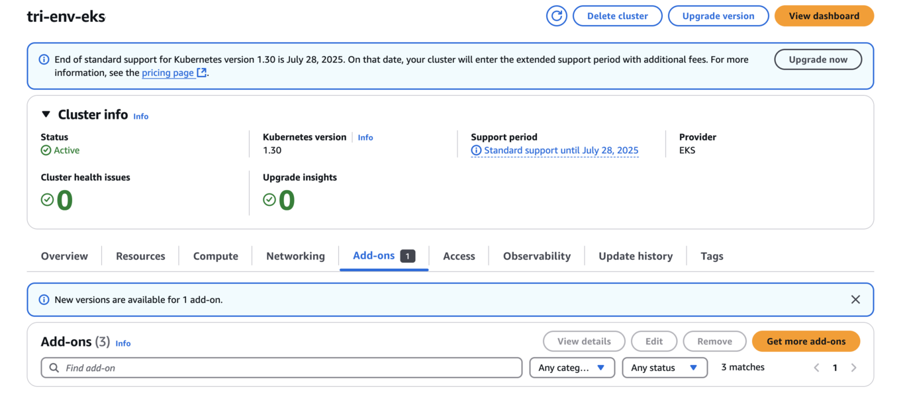
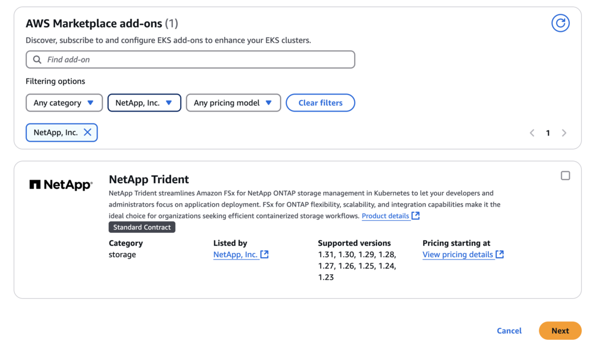
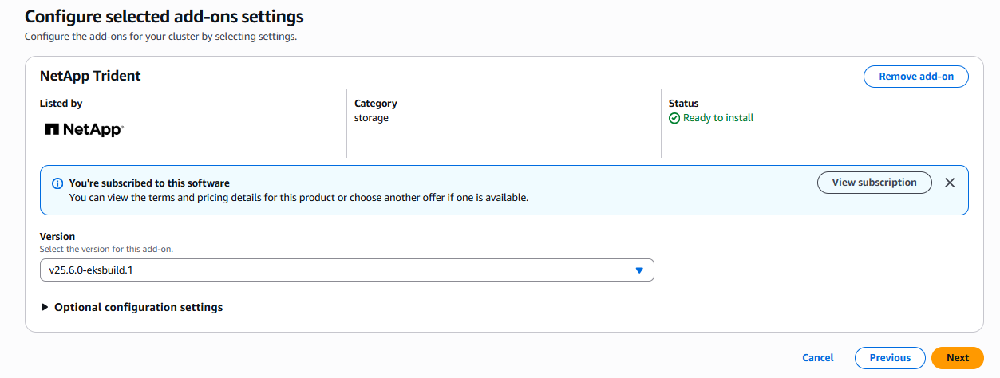

= Configura el complemento Trident EKS en un clúster EKS
:hardbreaks:
:allow-uri-read: 
:icons: font
:imagesdir: ../media/

[role="lead"]
NetApp Trident optimiza la gestión del almacenamiento de Amazon FSx for NetApp ONTAP en Kubernetes para que tus desarrolladores y administradores puedan centrarse en la puesta en marcha de aplicaciones. El complemento NetApp Trident EKS incluye los últimos parches de seguridad, correcciones de errores y está validado por AWS para funcionar con Amazon EKS. El complemento EKS te permite asegurarte de forma constante de que tus clústeres de Amazon EKS sean seguros y estables, y reducir la cantidad de trabajo que necesitas hacer para instalar, configurar y actualizar complementos.

[[prerequisites]]
== Prerrequisitos

Asegúrate de tener lo siguiente antes de configurar el complemento Trident para AWS EKS:

* Una cuenta de clúster de Amazon EKS con permisos para trabajar con complementos. Consulta link:https://docs.aws.amazon.com/eks/latest/userguide/eks-add-ons.html["Complementos de Amazon EKS"^].
* Permisos de AWS para AWS marketplace:
`"aws-marketplace:ViewSubscriptions",
"aws-marketplace:Subscribe",
"aws-marketplace:Unsubscribe`
* Tipo de AMI: Amazon Linux 2 (AL2_x86_64) o Amazon Linux 2 Arm(AL2_ARM_64)
* Tipo de nodo: AMD o ARM
* Un sistema de archivos existente de Amazon FSx para NetApp ONTAP

[[steps]]
== Pasos

. Asegúrate de crear un rol de IAM y un secreto de AWS para que los pods de EKS puedan acceder a los recursos de AWS. Para ver las instrucciones, consulta link:../trident-use/trident-fsx-iam-role.html["Crea un rol de IAM y un secreto de AWS"^].
. En tu clúster EKS Kubernetes, ve a la pestaña *Add-ons*.
+

. Ve a *AWS Marketplace add-ons* y elige la categoría _storage_.
+

. Localiza *NetApp Trident* y selecciona la casilla para el complemento Trident, y haz clic en *Siguiente*.
. Elige la versión deseada del complemento.
+

. Configura los ajustes complementarios necesarios.
+
image::../media/aws-eks-04.png[Ajustes de configuración del complemento Trident]

. Si estás usando IRSA (IAM roles para service account), consulta los pasos de configuración adicionales link:https://docs.netapp.com/us-en/trident/trident-use/trident-fsx-install-trident.html#enable-the-trident-add-on-for-aws["aquí"].
. Selecciona *Crear*.
. Verifica que el estado del complemento sea _Activo_.
+
image::../media/aws-eks-05.png[Estado activo del add-on Trident]

. Ejecuta el siguiente comando para verificar que Trident está instalado correctamente en el clúster:
+
[listing]
----
kubectl get pods -n trident
----
. Continúa con la configuración y configura el backend de almacenamiento. Para más información, consulta link:trident-fsx-storage-backend.html["Configura el backend de almacenamiento"].

[[installuninstall-the-trident-eks-add-on-using-cli]]
== Instala o desinstala el complemento Trident EKS usando la CLI

.Instala el complemento Trident EKS de NetApp usando la CLI:
El siguiente comando de ejemplo instala el complemento Trident EKS:
`eksctl create addon --cluster clusterName --name netapp_trident-operator --version v25.6.0-eksbuild.1` (con una versión dedicada)

El siguiente comando de ejemplo instala el complemento Trident EKS versión 25.6.1:
`eksctl create addon --cluster clusterName --name netapp_trident-operator --version v25.6.1-eksbuild.1` (con una versión dedicada)

El siguiente comando de ejemplo instala el complemento Trident EKS versión 25.6.2:
`eksctl create addon --cluster clusterName --name netapp_trident-operator --version v25.6.2-eksbuild.1` (con una versión dedicada)

.Desinstala el complemento Trident EKS de NetApp usando la CLI:
El siguiente comando desinstala el complemento Trident EKS:

[listing]
----
eksctl delete addon --cluster K8s-arm --name netapp_trident-operator
----